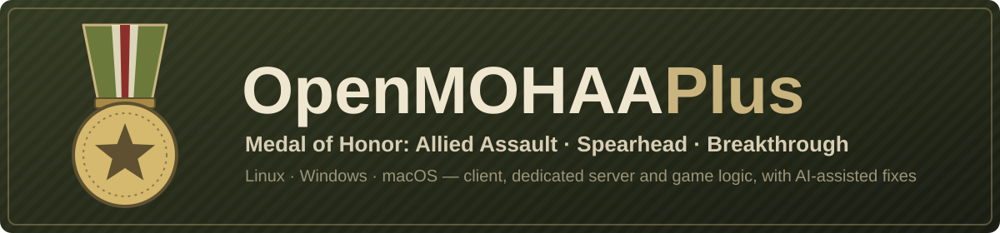

# OpenMOHAA Plus

<p align="center"></p>


[](https://github.com/openmoh/openmohaa)
[](https://github.com/OpenGamePlus/OpenMOHAA-Plus/actions/workflows/branches-build.yml)
[](https://github.com/OpenGamePlus/OpenMOHAA-Plus/commits/main)

[Español](README.es.md) · **English**

**Medal of Honor: Allied Assault is still alive.** OpenMOHAA Plus is a fork of
[OpenMoHAA](https://github.com/openmoh/openmohaa), the open-source reimplementation of Medal of
Honor: Allied Assault, Spearhead and Breakthrough: the client, the dedicated server and the game
logic, for Windows, Linux and macOS.

It exists for one reason: **to move forward with AI coding agents**, which the original project
does not accept. Here every change is made with an assistant, reproduced on the real game before
and after, and kept in this fork. On top of OpenMoHAA's work we fix reported bugs and add new
features, the way the sibling project [OpenCoD2-Plus](https://github.com/OpenGamePlus/OpenCoD2-Plus)
is doing for Call of Duty 2 with its 40 Hz server.

<table>
  <tr>
    <td></td>
    <td></td>
  </tr>
  <tr>
    <td></td>
    <td></td>
  </tr>
</table>
<p align="center"><sub>Screenshots from OpenMoHAA; the engine and game code are the same.</sub></p>

## What works today

Everything [OpenMoHAA](https://github.com/openmoh/openmohaa) does: the whole single-player campaign
of the three games, all official multiplayer modes (Free-For-All, Team Deathmatch, Round-based,
Objective, Tug-of-War, Liberation), mods such as Freeze-Tag, built-in bots, and compatibility with
the original assets, scripts and servers
([differences from the original](docs/markdown/01-intro/04-differences.md)). On top of that:

### For players

- [HUD scale, crosshair size and 4:3 menus](docs/markdown/03-configuration/05-plus-hud.md) on wide
  screens (`ui_hudscale`, `cg_crosshair_size`, `ui_menuaspect`)
- [fonts with accented letters](docs/markdown/03-configuration/09-plus-fonts.md), sharper at high
  resolutions, and [community translations](docs/markdown/03-configuration/07-plus-translations.md)
  of the game's texts (`cl_language`)
- a [server browser](docs/markdown/03-configuration/06-plus-server-browser.md) with favorites,
  history, search and working game type filters, that no longer freezes when the master servers'
  DNS hangs (#376)
- automatic mod downloads over HTTP (`sv_dlURL`), and the reason shown when a server drops you
- the game folder found on its own for GOG and the original `EA GAMES\MOHAA` install (also inside
  Wine), an AppImage for Linux and the Steam Deck
- HRTF audio for headphones (`s_hrtf 1`)
- an experimental [Vulkan renderer](docs/markdown/03-configuration/12-plus-vulkan.md) (`cl_renderer vulkan`, Linux builds)

### For servers and competitive play

- 40 Hz servers (`sv_fps 40`) with the original 20 Hz fire rates, and `sv_perf` frame timings
- [lag compensation](docs/markdown/03-configuration/11-plus-antilag.md) for bullets (`g_antilag`)
- [match pause, hit sounds and hit markers](docs/markdown/03-configuration/08-plus-match-control.md),
  and a [competition match mod](misc/mods/plus-match/README.md) (halftime side switch, timeouts)
- [in-game admin accounts](docs/markdown/03-configuration/04-plus-admin.md) with roles and
  per-command permissions, no RCON password needed (`ad_login`)
- [bot skill levels, weapon choice and grenades](docs/markdown/03-configuration/10-plus-bots.md)
- freeze and crash reports

### For modders and scripters

- script events to change damage and refuse team changes, round events
  ([docs](docs/markdown/04-coding/02-scripting/03-plus-events.md))
- HTTP and JSON functions compatible with NightFall
  ([docs](docs/markdown/04-coding/02-scripting/04-plus-libmoh.md)), and a
  [stats mod](misc/mods/plus-stats/README.md) built on them
- server scripts without overwriting game files (`sv_scripts`)
- a script checker and a VS Code extension ([misc/scr-tools](misc/scr-tools),
  [misc/vscode-mohaa](misc/vscode-mohaa))

### Fixes for bugs reported upstream

Each one reproduced before and after on the real game:

- `s_dialogscale` above 1 now raises dialog volume (#885)
- `com_maxfps` caps at the requested rate: 144 gives 144 fps, not 166 (#530)
- the HUD stopwatch survives loading a save (#916)
- map scripts no longer burst all their waits after a same-map restart, which dropped every player
  on single-map servers (#287)
- no crash on map change when the game or client module stays loaded, as on Alpine/musl (#918)
- `sv_pure 1` no longer rejects clients that read an extra pk3 in the menu (#659)
- `rehashbans` no longer keeps removed bans (#926)
- script fixes: `registercmd` commands run (#672), item `amount`/`dmamount` are readable (#920),
  `waitForState` waits (#702)
- sounds whose alias omits `.wav` load (#589), a cursor double free, and executable release
  archives on Linux and macOS (#923)

Numbers are [upstream issues](https://github.com/openmoh/openmohaa/issues). The server options that
change how a match plays (40 Hz, lag compensation, hit sounds and markers) are off by default, so a
server plays like the original until its admin turns them on. The full list, with the risks each change brings, is in
[docs/ai/SYSTEM_SUMMARY.md](docs/ai/SYSTEM_SUMMARY.md) and
[docs/dev/roadmap/debt.md](docs/dev/roadmap/debt.md).

> [!NOTE]
> **Still in development.** Expect bugs and missing pieces. Behaviour changes against the original
> are listed in [docs/dev/roadmap/debt.md](docs/dev/roadmap/debt.md).

> [!IMPORTANT]
> **No game content is included: bring your own data.** This repository is source code only. To
> play you need the files of a copy of Medal of Honor: Allied Assault (and optionally Spearhead and
> Breakthrough) that **you legally own**.

## How to play

Development builds are published automatically on the
[`dev` pre-release](https://github.com/OpenGamePlus/OpenMOHAA-Plus/releases/tag/dev). Otherwise build
it (see [Building](#building)). On Linux and the Steam Deck the simplest is the AppImage: put
`OpenMOHAA-Plus-x86_64.AppImage` in your game folder (the one with `main/`), `chmod +x` it and run it
(`--dedicated`, `--spearhead` or `--breakthrough` for the server and the expansions). Installation
works as in OpenMoHAA:

- [Installing](docs/markdown/01-intro/01-installation.md), [running the game and expansions](docs/markdown/02-running/01-running.md), [FAQ](docs/markdown/02-running/03-faq.md)
- [Setting up a server](docs/markdown/02-running/02-running-server.md), [bots](docs/markdown/03-configuration/03-configuration-bots.md), [configuration](docs/markdown/03-configuration/01-configuration.md)

From a build, point it at your game folder, the one that contains `main/` (not needed when the
build sits in that folder, for a GOG install on Windows, or for the original installer's
`EA GAMES\MOHAA` folder, also inside the default Wine prefix):

```sh
./openmohaa +set fs_basepath /path/to/MOHAA
./omohaaded +set fs_basepath /path/to/MOHAA +map dm/mohdm1     # dedicated server
```

## Game versions

| Game | Data folder | Start it with |
|---|---|---|
| Allied Assault | `main` | `openmohaa`, or `+set com_target_game 0` (default) |
| Spearhead | `mainta` | `launch_openmohaa_spearhead`, or `+set com_target_game 1` |
| Breakthrough | `maintt` | `launch_openmohaa_breakthrough`, or `+set com_target_game 2` |

The network protocol follows the game, so each one plays on its own original servers. Only Allied
Assault is tested here; Spearhead and Breakthrough are built but untested
([running the expansions](docs/markdown/02-running/01-running.md)).

## Roadmap

The work follows a [plan in phases](docs/dev/roadmap/ideas.md#prioritized-plan), with its live
progress in [docs/ai/SYSTEM_SUMMARY.md](docs/ai/SYSTEM_SUMMARY.md#open-work) (November 2026):

| Phase | State |
|---|---|
| 0. Foundations (versions, tests, crash reports) | done |
| 1. Quality (sanitizers, fuzzing, profiling, upstream sync) | done |
| 2. Script platform (gametype events, HTTP/JSON, toolkit) | done |
| 3. Competitive and online | nearly done: bots that play objectives (#602) and validation of impossible hits are left |
| 4. Player experience | nearly done: match demos, a Flatpak and loading saves from the original game (#601) are left |
| 5. Big bets (campaign co-op, WebAssembly, Vulkan, community portal) | started: a first Vulkan renderer |

Upstream bugs keep being fixed alongside, picked by what can be reproduced and verified. Tested on Linux with the original
Allied Assault data; Windows and macOS are built by CI but less tested, and Spearhead and
Breakthrough are not tested here.

## For contributors

Playing and reporting bugs, testing on other systems, or code: every kind of help counts. Do not
send this fork's changes to the original repository: its rules forbid AI-generated contributions.
The technical documentation, in English, starts at [docs/dev/README.md](docs/dev/README.md);
[AGENTS.md](AGENTS.md) is the entry point for AI coding agents.

## Building

CMake and Ninja. Dependencies for every platform:
[docs/markdown/04-coding/01-compiling.md](docs/markdown/04-coding/01-compiling.md). On Linux:

```sh
cmake -S . -B .cmake -G Ninja -DCMAKE_BUILD_TYPE=RelWithDebInfo -DCMAKE_INSTALL_PREFIX=$HOME/omohaa
cmake --build .cmake
cmake --install .cmake        # -> $HOME/omohaa/lib/openmohaa: openmohaa, omohaaded, game.so, cgame.so...
```

<details>
<summary><b>Build options</b></summary>

| Option | Default | Effect |
|---|---|---|
| `BUILD_RENDERER_VULKAN` | `ON` | `renderer_vulkan`, when the Vulkan headers are found and `USE_RENDERER_DLOPEN` is on ([notes](docs/dev/architecture/renderer-vulkan.md)) |
| `BUILD_RENDERER_GL2` | `OFF` | `renderer_opengl2`, not usable for MOHAA yet |
| `USE_RENDERER_DLOPEN` | `ON` | renderers as loadable modules instead of linked in |
| `BUILD_TESTING` | `ON` | CTest unit tests (`test_lz77`) |

More in [docs/dev/development/compiling.md](docs/dev/development/compiling.md).

</details>

## Testing

<details>
<summary><b>The tests and checkers</b></summary>

Bugs are verified on the real binaries without opening windows or playing sound: offscreen
client, null audio, scripted console input, bots, screenshots and audio rendered to a file.

```sh
ctest --test-dir .cmake                                # unit tests
OMOH_GAME_DIR=/path/to/MOHAA python3 -I -m unittest discover -s tests          # game tests, headless
OMOH_GAME_DIR=/path/to/MOHAA OMOH_SLOW=1 python3 -I -m unittest discover -s tests   # with the slow ones
python3 -I misc/scr-tools/test_scr_tools.py           # script checker
python3 -I -m unittest discover -s misc/fonts          # font generator
python3 -I -m unittest discover -s misc/i18n           # localization tool
python3 -I -m unittest discover -s misc/docs-check     # docs checker tests
python3 -I misc/docs-check/check_docs.py               # docs checker
```

- `tests/test_server.py` and `tests/test_client.py` reproduce every fixed bug and every Plus feature
  on a dedicated server and a headless client; each test was checked to fail before its fix. They
  need Allied Assault data and are skipped without it; the list is in [tests/README.md](tests/README.md).
- The recipes for new checks are in [docs/dev/development/testing.md](docs/dev/development/testing.md).

</details>

## Repository layout

<details>
<summary><b>What is where</b></summary>

| Path | Contents |
|---|---|
| `code` | The engine (`qcommon`, `server`, `client`, `sys`, `sdl`), the game modules (`fgame`, `cgame`), the script VM (`script`, `parser`, `corepp`), the renderers (`renderergl1`, `renderervk`...), `uilib` and the vendored `thirdparty` and `gamespy` libraries |
| `cmake` | Build definitions for each output |
| `tests` | Headless game regression tests (Python, stdlib) |
| `misc/mods` | Reference script mods: `plus-match` (competition) and `plus-stats` (HTTP stats) |
| `misc/scr-tools`, `misc/vscode-mohaa` | Script checker and VS Code extension |
| `misc/fonts`, `misc/i18n` | Font generator for accented letters and localization tool |
| `misc/linux`, `misc/macos`, `misc/windows` | Packaging: the Linux AppImage, the macOS disk image, icons |
| `misc/docs-check` | The documentation checker |
| `docs/markdown` | User documentation (OpenMoHAA's, plus the `*plus-*.md` pages of this fork) |
| `docs/dev`, `docs/ai` | Technical documentation: [architecture](docs/dev/architecture/overview.md), decisions, debt, and the memory layer for AI agents |

</details>

## Transparency

- **Who maintains this:** OpenGamePlus. I like old games, and I want to keep playing them with my
  friends and keep them alive for the community, with open projects. This one sits next to
  [OpenCoD2-Plus](https://github.com/OpenGamePlus/OpenCoD2-Plus).
- **How the work is done:** I work with [Claude Code](https://claude.com/claude-code), Anthropic's
  coding assistant. The changes in this fork, including this README, are written with its help.
  Commits made this way carry a `Co-Authored-By: Claude` line, so they can be found with `git log`.
- **Relationship with the original:** the engine and game reimplementation are the work of the
  OpenMoHAA contributors. This fork follows their `main` and merges it in; it never sends its own
  changes back, because OpenMoHAA does not accept AI-generated contributions
  ([ADR 0001](docs/dev/architecture/adr/0001-fork-keeps-ai-assisted-work.md)). Please report bugs
  of this fork here, not to OpenMoHAA.
- **What it is not:** it is not an official project and is not affiliated with Electronic Arts,
  2015 Inc. or the OpenMoHAA team. It contains no game files.

## Notice

OpenMOHAA Plus is an independent project. It is not affiliated with, authorized by, sponsored by,
or endorsed by Electronic Arts Inc. or any of its affiliates. "Medal of Honor" is a trademark of
Electronic Arts Inc., used here only to identify the game the code is compatible with.

This project does not provide or help obtain copyrighted game data. To use it with real game
content, you must supply data files from a copy of Medal of Honor: Allied Assault that you legally
own.

If you are a rights holder and believe something here should not be distributed, please open an
issue or contact the maintainer and it will be addressed promptly.

The screenshots show content of Medal of Honor: Allied Assault, property of Electronic Arts Inc.,
for identification only.

## License

[GNU Affero General Public License v3.0](LICENSE). Whoever distributes the game, or runs a
modified version as a server for others, must offer its source under the same license. The code
written for this fork is AGPL-3.0-or-later; the code that comes from OpenMoHAA, ioquake3 and the
F.A.K.K. 2 SDK keeps its GPL-2.0-or-later notices ([COPYING.txt](COPYING.txt)), which allow it
to be distributed as part of an AGPL-3.0 program
([ADR 0006](docs/dev/architecture/adr/0006-fork-licensed-agpl-3.md)). Third-party libraries keep their own licenses:
[Flex](https://github.com/westes/flex), [Bison](https://savannah.gnu.org/projects/bison/),
[SDL](https://www.libsdl.org/), [OpenAL Soft](https://openal-soft.org/),
[libmad](https://www.underbit.com/products/mad/), [cURL](https://curl.se/),
[libogg and libvorbis](https://xiph.org/vorbis/), [Opus](https://opus-codec.org/),
[Recast Navigation](https://github.com/recastnavigation/recastnavigation), zlib and libjpeg
(sources in `code/thirdparty`).

## Credits

- [OpenMoHAA](https://github.com/openmoh/openmohaa) and its contributors, the reimplementation this fork is built on
- [ioquake3](https://github.com/ioquake/ioq3) and id Software, the engine
- Ritual Entertainment's [F.A.K.K. 2 SDK](https://code.idtech.space/ritual/fakk2-sdk)
- 2015 Inc. and Electronic Arts, Medal of Honor: Allied Assault

## Resources

[MOH-DB](https://www.moh-db.com/) · [333networks](https://333networks.com/) ·
[ModDB](https://www.moddb.com/games/medal-of-honor-allied-assault) ·
[GameBanana](https://gamebanana.com/games/720) ·
[OpenMoHAA documentation](https://openmoh.github.io/openmohaa) ·
[OpenMoHAA Discord](https://discord.gg/NYtH58R) (upstream community)
